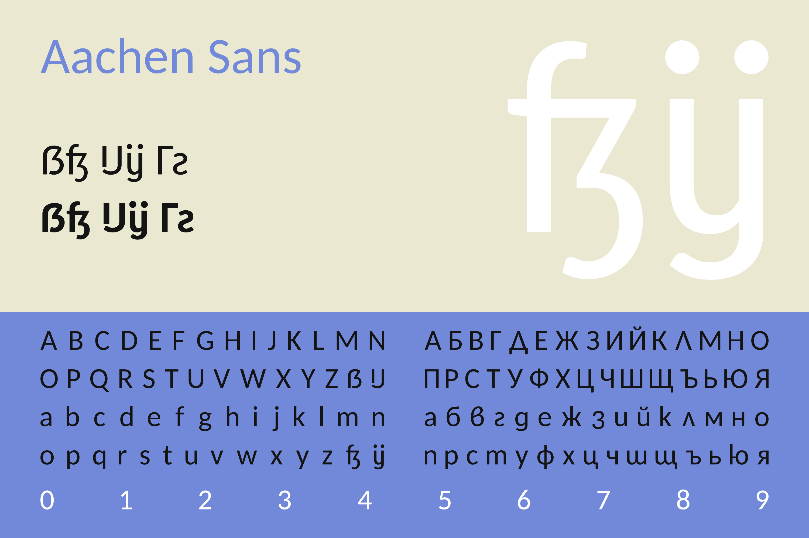
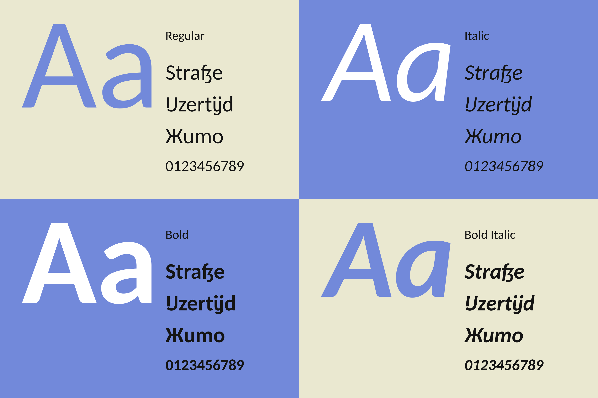
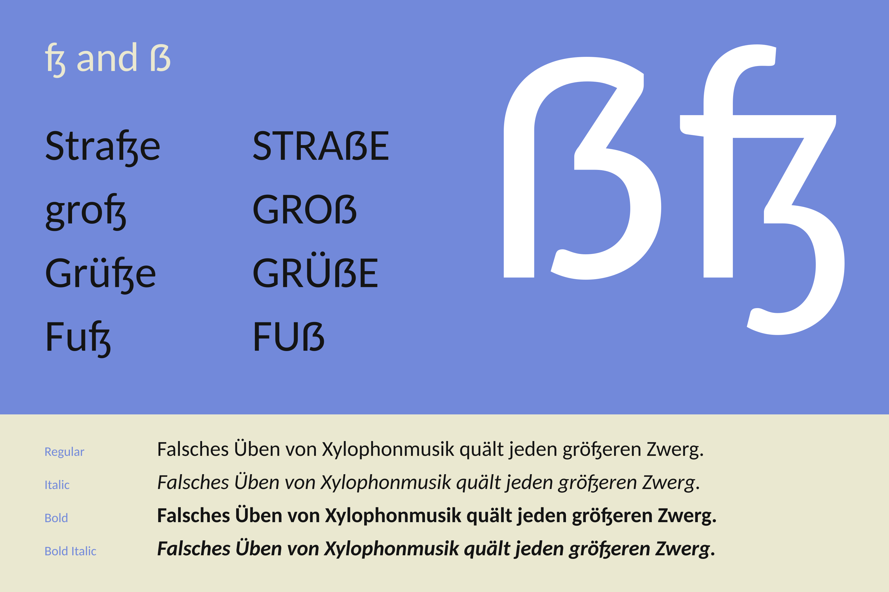
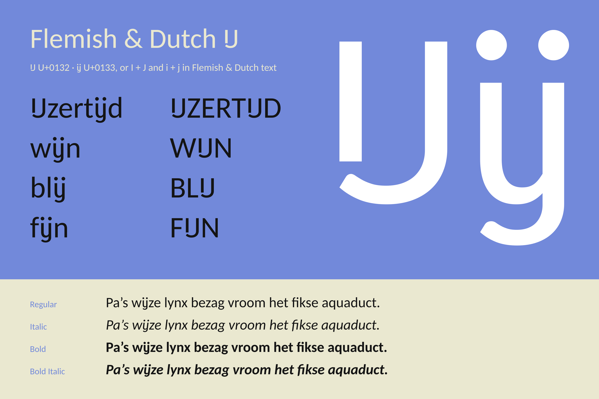
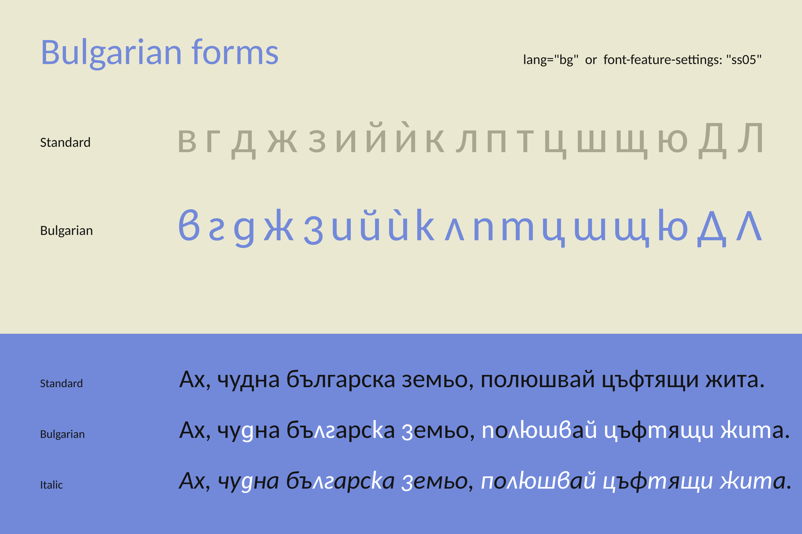
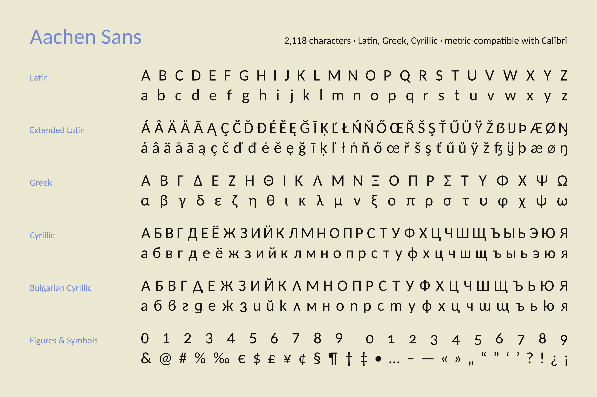

# Aachen Sans

A humanist sans serif forked from **Carlito 1.103** by tyPoland Łukasz Dziedzic, with:

- a redesigned **ß** in the long s + ezh (ſʒ) form, descending like ʒ, and a round-topped **ẞ** to match
- **Flemish & Dutch IJ ij** ligatures, with i + j joining automatically in Flemish & Dutch text
- **Bulgarian** letterforms

Every other glyph, all kerning and every advance width are Carlito's, so Aachen Sans stays metric-compatible
with Calibri. Four styles: Regular, Italic, Bold, Bold Italic.

**[Preview and download Aachen Sans](https://crweul.github.io/aachen-sans/)** ·
[full glyph list](https://crweul.github.io/aachen-sans/glyphs.html)



## ß and ẞ

The small eszett is the long s joined to a ʒ that descends like the letter ʒ; the capital rises from its stem in
one round arch.



## Flemish & Dutch IJ

Typed i + j joins into ij in Flemish & Dutch text, and the IJ and ij characters always use this design.



## Bulgarian forms

Bulgarian text gets the rounder, handwriting-derived lowercase that Bulgarian readers expect.



## Character set

2,118 characters: Latin, extended Latin, Greek, Cyrillic and Bulgarian Cyrillic, figures and symbols.
[See every glyph on the website](https://crweul.github.io/aachen-sans/glyphs.html).



## The name

Aachen is the city where Germany, Belgium and the Netherlands meet, just as this font brings together the
German ß and the Flemish & Dutch IJ.

## Use

Fonts are in [`fonts/ttf`](fonts/ttf) (desktop) and [`fonts/webfonts`](fonts/webfonts) (WOFF2).

```css
@font-face {
  font-family: "Aachen Sans";
  src: url("AachenSans-Regular.woff2") format("woff2");
  font-weight: 400;
  font-style: normal;
}
```

- **Flemish & Dutch:** set `lang="nl-BE"` or `lang="nl"` and typed i + j becomes ij. Loanwords such as
  *Beijing*, *Fiji* or *hijab*, and compounds such as *minijurk*, stay as two letters. To keep any other word
  apart, put `&zwnj;` between the i and the j. The IJ and ij characters (U+0132, U+0133) always use the new
  design.
- **Bulgarian:** set `lang="bg"`, or use `font-feature-settings: "ss05"` anywhere.
- **IJ in other languages:** type the IJ ij characters, or wrap the word in `<span lang="nl-BE">`.

## License

[SIL Open Font License 1.1](LICENSE), with Reserved Font Names "Carlito" and "Aachen Sans". The fonts are free
to use, including on websites and in apps. Modified versions must stay under the same license and may not use
the name Aachen Sans.
